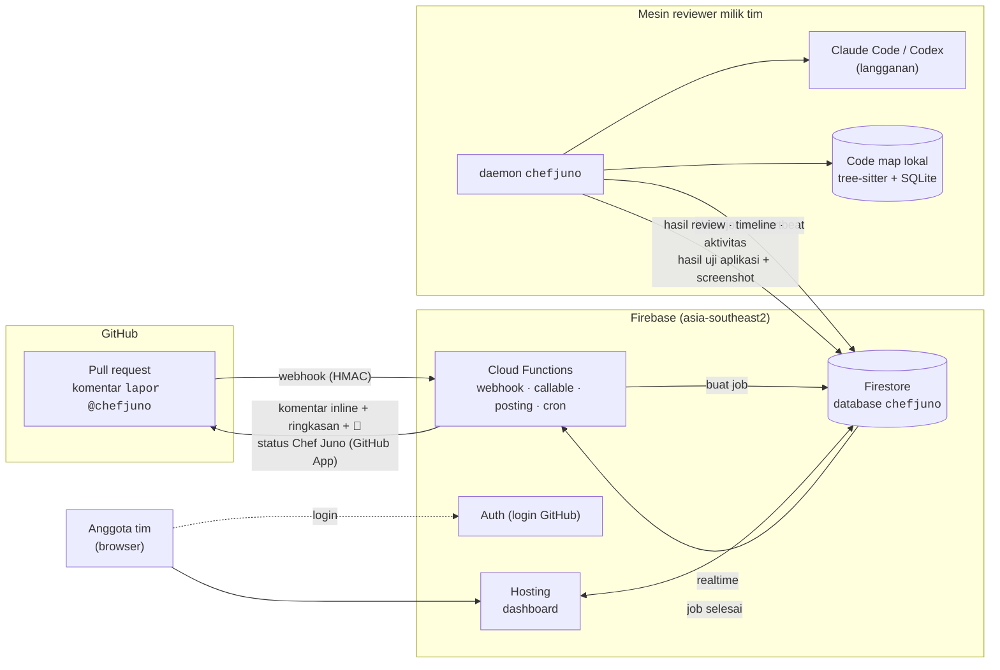

# Ringkasan & arsitektur

Chef Juno terdiri dari tiga bagian yang tidak saling memanggil secara langsung. Mereka bertemu di **Firestore**:
Functions menulis job, mesin reviewer mengambil dan mengerjakannya, dashboard menampilkan semuanya secara realtime.

## Bagian-bagiannya

| Bagian | Berjalan di | Tugas |
|---|---|---|
| **Cloud Functions** | Firebase | Menerima webhook GitHub, membuat job, memberi token GitHub sementara ke mesin, memposting hasil review & uji aplikasi, memasang status `Chef Juno`, menyajikan screenshot bukti, merawat antrean, menghitung rapor mingguan |
| **Firestore** | Firebase | Antrean job, hasil review, temuan, bukti uji, aktivitas agent, memory tim, skill, prompt, mesin, anggota — juga papan status untuk dashboard |
| **Daemon `chefjuno`** | Mesin anggota tim / server | Mengambil job, menyiapkan worktree & konteks, menjalankan agent, menyiapkan emulator untuk uji aplikasi, menulis hasil |
| **Agent** | Mesin yang sama | Claude Code atau Codex yang **sudah login dengan langganan**. Server tidak pernah memanggil model |
| **Dashboard** | Browser (Angular) | Review Kode, Memory, Knowledge Base, Analitik, Rapor, Mesin, Skills, Pengaturan, Setup |

## Prinsip desain

- **Model tidak pernah dipanggil dari server.** Semua pemanggilan model terjadi di mesin tim lewat CLI resmi yang login
  dengan langganan. Tidak ada mode API key.
- **Firestore adalah antrean dan sumber kebenaran.** Dashboard dan daemon membaca perubahan secara realtime; tidak ada
  server lain yang harus dirawat.
- **Penulisan sensitif lewat Functions.** Klien hanya boleh menulis field terbatas, dijaga security rules.
- **Hasil bisa dilacak.** Setiap job mem-pin versi prompt, versi skill, dan konfigurasinya saat dibuat, jadi review
  bisa dijelaskan ulang kapan pun.
- **Jujur soal batas.** Review yang tidak bisa dinilai penuh diberi label *Review sebagian*, bukan "bersih"; PR yang
  belum dicoba di aplikasi diberi status *Belum teruji*, bukan lulus.
- **Jarang memblokir, selalu membuktikan.** Prinsip 10 skill inti: temuan yang memblokir harus punya bukti.
