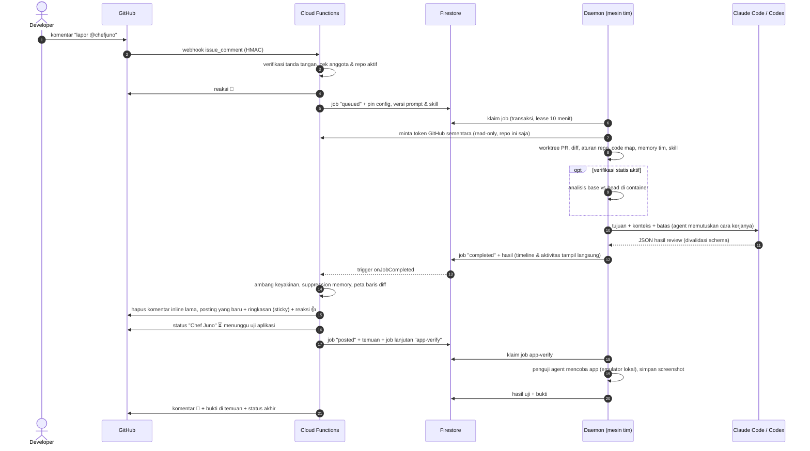
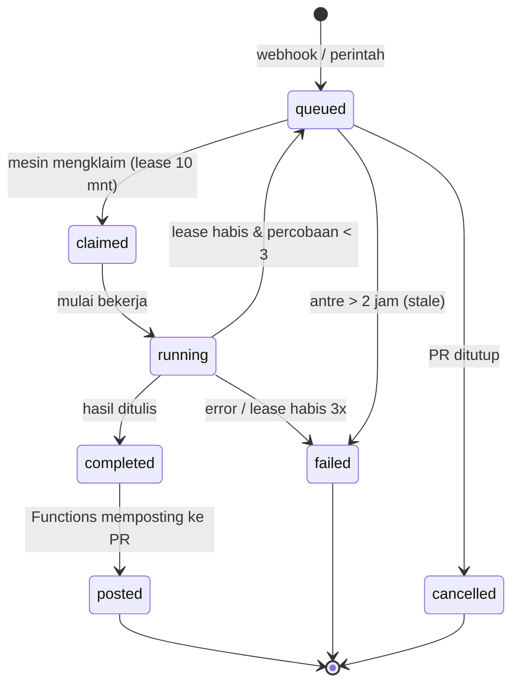
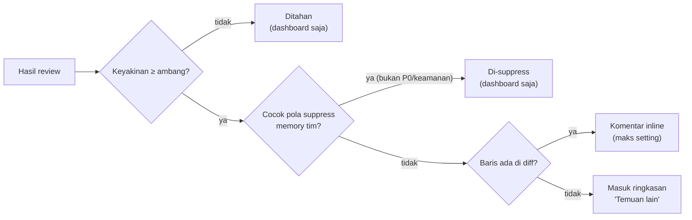

# Cara kerja review

Review dimulai saat seseorang menulis `lapor @chefjuno` (atau `cek` / `review`) di pull request. Dari situ ada enam tahap:
**terima → antre → klaim → review → posting → uji aplikasi**.

## 1. Terima

Functions memverifikasi tanda tangan webhook dan menyimpan ID delivery (event yang sama tidak diproses dua kali).
Pemanggil harus **anggota** tim; repo harus **aktif** di Pengaturan. Kalau sudah ada review aktif untuk commit yang sama,
tidak dibuat job baru.

## 2. Antre

Job dibuat berstatus `queued` dan **mem-pin** semua yang menentukan hasil: konfigurasi (ambang, batas, model per
tingkat), versi prompt inti, dan versi skill yang aktif. Siapa yang meminta review (`trigger`) juga dicatat. Kalau tidak ada mesin online, Chef Juno membalas di PR bahwa job masuk antrean.

## 3. Klaim

Daemon di mesin tim mengirim heartbeat (dianggap offline setelah 90 detik tanpa kabar) dan mengklaim job lewat transaksi,
jadi satu job tidak pernah dikerjakan dua mesin. Pemeliharaan tiap 5 menit mengembalikan job yang lease-nya habis ke antrean
(maksimal 3 percobaan). Kalau `preferredAgent = Bebas`, mesin memilih agent yang paling lama tidak dipakai supaya beban
langganan tersebar.

## 4. Review

Daemon menyiapkan konteks:

| Konteks | Sumber |
|---|---|
| Diff & daftar file | worktree PR (diff dipotong di batas `maxDiffBytes` → review diberi label *sebagian*) |
| Aturan repo | `.chefjuno/rules.md`, `CLAUDE.md`, `AGENTS.md` dari **branch tujuan** |
| Konteks code map | simbol yang berubah, pemanggil, yang dipanggil, test terkait, ringkasan modul |
| Memory tim | aturan tim yang disetujui & cocok dengan path, fakta yang diingat (`@chefjuno ingat`, pelajaran uji aplikasi), profil kesalahan berulang penulis PR |
| Skill | 10 skill inti (selalu) + skill tim yang `paths:`-nya cocok dengan file yang berubah |
| Verifikasi statis (opsional) | masalah analisis statis yang **baru** di PR (lihat [Kustomisasi](06-kustomisasi.md)) |

Agent dijalankan sesuai mode (lihat [Keamanan](07-keamanan.md)) dan wajib mengembalikan JSON sesuai schema:
temuan (`path`, `line`, `severity` P0–P2, `category`, `what`, `why`, `fix`, `suggestion`, **`confidence`**, **`trigger`**),
`score` 0–5, `verdict`, `summary`, `lessons`, **`reviewCompletion`**, dan `uncertainty`. Output yang tidak sesuai schema,
atau yang memuat token/rahasia mesin, membuat job gagal — tidak pernah diposting.

Bawaan: **mode tujuan** — satu agent dengan tujuan, konteks, dan batas yang memutuskan sendiri cara memeriksa
(boleh menjalankan test/build dan memecah kerja ke subagent). `lapor @chefjuno dalam` memakai pipeline lama yang
read-only. PR yang hanya mengubah dokumentasi tidak diuji di aplikasi — lihat [Standar review](03-review-mendalam.md).

## 5. Posting

- **Semua tingkat diposting:** P0, P1, dan P2. Hanya temuan di bawah *Ambang keyakinan* (default 70%) yang tidak
  diposting; tetap tersimpan di bagian **Ditahan** pada detail review.
- **Suppression:** pola yang sudah diputuskan tim bukan masalah tidak diposting. Temuan **keamanan dan P0 tidak pernah di-suppress**.
- **Review ulang mengganti yang lama:** komentar inline Chef Juno sebelumnya di PR itu dihapus dulu, kecuali yang
  sudah dibalas atau diberi reaksi (diskusi & bahan belajar tim tetap ada). Komentar tidak menumpuk.
- **Ringkasan sticky:** satu komentar ringkasan per PR yang diperbarui setiap review ulang: skor, verdict, jumlah temuan
  per tingkat, dampak dari code map, pelajaran untuk penulis, dan catatan bila ada temuan yang ditahan/di-suppress.
- **Review sebagian:** kalau agent melapor `incomplete` atau diff terpotong, skor dibatasi maksimal 3, ringkasan diberi
  label ⚠️ *Review sebagian*, dan PR tidak pernah berstatus *Siap merge* di dashboard.

## Status lulus/gagal di PR (gate)

Setiap review memasang commit status **`Chef Juno`** di head PR:

| Saat | Status | Keterangan |
|---|---|---|
| Job dibuat | ⏳ pending | "Sedang direview…" |
| Diposting, ada P0/P1 atau review sebagian | ❌ failure | mis. `FAIL · 2 P1, 1 P2 · skor 3/5` (langsung; uji tetap jalan) |
| Diposting, kode PASS / PASS+NOTES | ⏳ pending | mis. `PASS+NOTES · 2 P2 · skor 4/5 · menunggu uji aplikasi` |
| Uji selesai, alur yang diubah berjalan + ada screenshot | ✅ success | `PASS · skor 5/5 · teruji di aplikasi` |
| Uji selesai, alur yang diubah rusak di app | ❌ failure | `FAIL · alur yang diubah rusak saat dicoba di aplikasi` |
| Belum teruji (uji tidak jalan, alur belum berhasil dicoba, atau tanpa screenshot) | ⚠️ error | `Belum teruji …` — **tidak pernah ✅** |
| Hanya dokumentasi | ✅/❌ | langsung dari temuan, tanpa uji aplikasi |
| Review gagal | ⚠️ error | "Review gagal (tahap …) — ulangi: lapor @chefjuno" |

Verdict kode dihitung dari temuan yang **benar-benar diposting** (sesudah ambang keyakinan & suppression). Detail uji
ada di [Uji aplikasi](09-uji-aplikasi.md). Tautan status
membuka detail review di dashboard. Jadikan `Chef Juno` *required check* di branch protection supaya PR yang FAIL tidak
bisa di-merge; agent penulis PR cukup membaca status ini (PASS / PASS+NOTES / FAIL) di head terakhir.

Butuh izin GitHub App **Commit statuses: Read and write**. Tanpa izin itu review tetap diposting; alasannya tercatat di
job (`github.statusError`).

## Pantau di dashboard

Detail review (**Review Kode → PR**) menampilkan:

- **Proses agent** — timeline per langkah (menyiapkan konteks, triase, tiap putaran spesialis, validasi, reviewer akhir,
  uji aplikasi) dengan status dan durasi, diperbarui langsung selama job berjalan.
- **Intip kerja agent (N aktivitas)** di tiap langkah — proses berpikir agent, alat yang dipakai (file dibaca, pencarian,
  perintah dijalankan), dan teks keputusannya, juga langsung. **Hasil alat dan isi file tidak pernah dicatat**, rahasia
  yang dikenali disensor, teks panjang dipotong. Lihat [Keamanan](07-keamanan.md#log-aktivitas-agent).
- **Riwayat review PR ini** — semua review untuk PR yang sama: siapa yang meminta, kapan, dan hasilnya, dengan tautan.

Di daftar **Review Kode**, PR diberi label **diminta @login** bila review terakhirnya diminta orang lain selain penulis PR.

## Setelah review

Penulis atau AI coder bisa membalas thread temuan dengan `chefjuno: diperbaiki` atau `chefjuno: tidak diperbaiki — <alasan>`.
Sinyal ini (plus 👍/👎, thread resolved, dan kode yang berubah di baris itu) menentukan **nasib** tiap temuan — bahan
Chef Juno untuk belajar. Lihat [Memory & knowledge base](05-memory-dan-knowledge.md).
