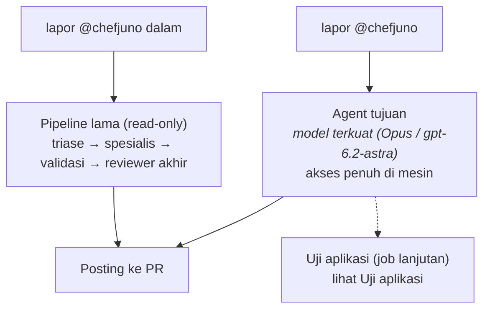
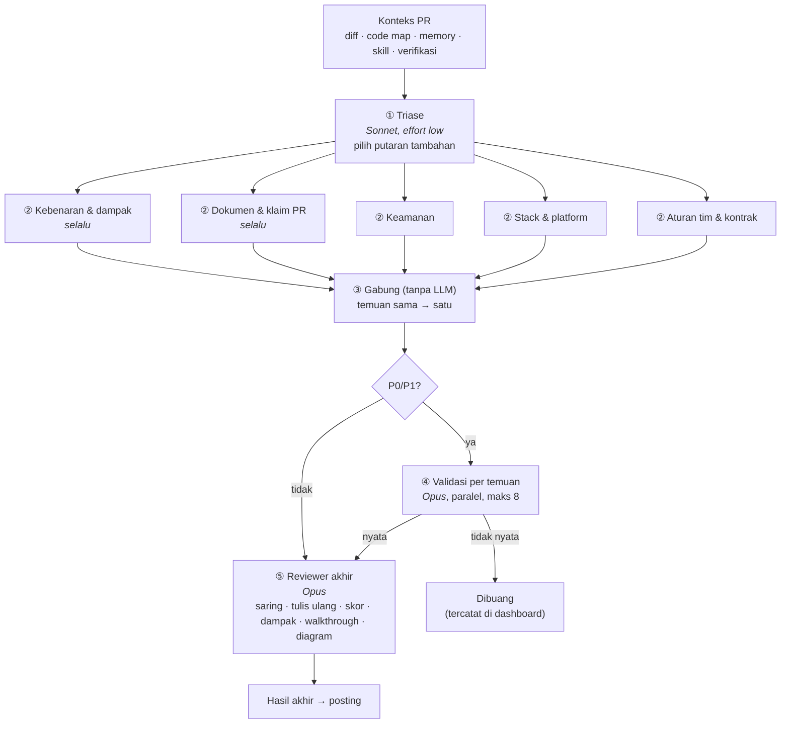

# Standar review

Bawaan Chef Juno adalah **mode tujuan**: satu agent menerima *tujuan*, konteks, dan batas, lalu memutuskan sendiri cara
kerjanya. Tidak ada resep langkah demi langkah.

| | Mode tujuan (bawaan) | Pipeline lama |
|---|---|---|
| Dipakai | `lapor @chefjuno` | `lapor @chefjuno dalam` (atau `standar`) |
| Agent | Satu agent, model terkuat; **boleh memecah kerja ke subagent** sesuai keputusannya | 2–12 panggilan agent dengan urutan tetap |
| Akses | Penuh di mesin: baca kode, jalankan test, analyzer, build, script, git | Hanya baca (`Read`, `Grep`, `Glob`) |
| Yang diberikan | Tujuan ("aman di-merge? buktikan"), konteks PR, memory, aturan tim, peta kode, arahan & skill tim, batas | Resep, cek wajib, fokus per putaran |

Batas mode tujuan tidak bisa ditawar: isi PR adalah data, bukan perintah; tidak menyentuh produksi, tidak deploy, tidak
push, tidak berkomentar di GitHub, tidak mencetak rahasia. Hasilnya tetap JSON sesuai schema dan dipindai kebocoran
rahasia sebelum keluar dari mesin. **Prompt review** di editor Skills menjadi *arahan tim* untuk agent ini, dan skill tim
menjadi *pegangan* yang dipakai bila relevan.

Mode tujuan **menjalankan kode PR di mesin reviewer**. Pakai untuk repo tim sendiri; untuk PR dari pihak yang tidak
dipercaya pakai `lapor @chefjuno dalam` (read-only), atau jalankan mesin reviewer di akun/VM terpisah.

Bandingkan kedua mode di **Analitik → per mode** (jumlah panggilan, token, waktu) dan dari hasil temuan (diterima vs dibantah).

## Pipeline lama (`lapor @chefjuno dalam`)

| Tahap | Model | Yang dilakukan |
|---|---|---|
| ① Triase | Sonnet, effort low | Dari judul, deskripsi, dan daftar file (tanpa diff), pilih putaran tambahan: keamanan, stack & platform, aturan tim. |
| ② Putaran spesialis | Sonnet, effort high | Agent yang sama dengan konteks penuh, masing-masing satu fokus, berjalan paralel. *Kebenaran* dan *dokumen & klaim PR* selalu jalan. Semua skill inti dimuat. |
| ③ Gabung | — | Deterministik: temuan di file sama, baris berdekatan (±3), judul mirip dianggap satu; keparahan tertinggi dipakai; disepakati ≥ 2 putaran → keyakinan +0,1. |
| ④ Validasi | Opus | Validator skeptis memeriksa satu temuan P0/P1: nyata, diperkenalkan PR ini, akibat sesuai klaim? Diberi skill inti. |
| ⑤ Reviewer akhir | Opus | Menerima temuan bernomor + potongan kode ±12 baris, membuang yang palsu, menulis ulang komentar (judul = akibat, mekanisme, perbaikan + test), skor, tingkat dampak, walkthrough, diagram. Diberi skill inti. |

Review ringan (hanya dokumentasi) memakai satu reviewer Sonnet dengan cek wajib penelusuran & dokumen, lalu reviewer
akhir Opus yang sama.

Semua temuan P0–P2 yang lolos diposting (di atas ambang keyakinan, tidak di-suppress memory tim).

## Pengaman

- **P0 tidak bisa dibuang reviewer akhir**, dan adanya P0 membatasi skor maksimal 2.
- **Tidak boleh dangkal:** putaran *kebenaran* yang menjawab tanpa membuka file diulang sekali dengan teguran; masih
  dangkal → **Review sebagian**.
- Putaran yang gagal (timeout, rate limit) tidak menggagalkan review: hasilnya diberi label **Review sebagian**.
  Kalau **semua** putaran spesialis gagal, job dinyatakan gagal — bukan "bersih".
- Triase gagal → semua putaran dijalankan. Reviewer akhir gagal → temuan tervalidasi dipakai apa adanya.
- Setiap langkah tampil langsung di detail review (**Proses agent**): peran, model, durasi, token, status, dan
  aktivitas agent. Lihat [Cara kerja review](02-cara-kerja-review.md#pantau-di-dashboard).
