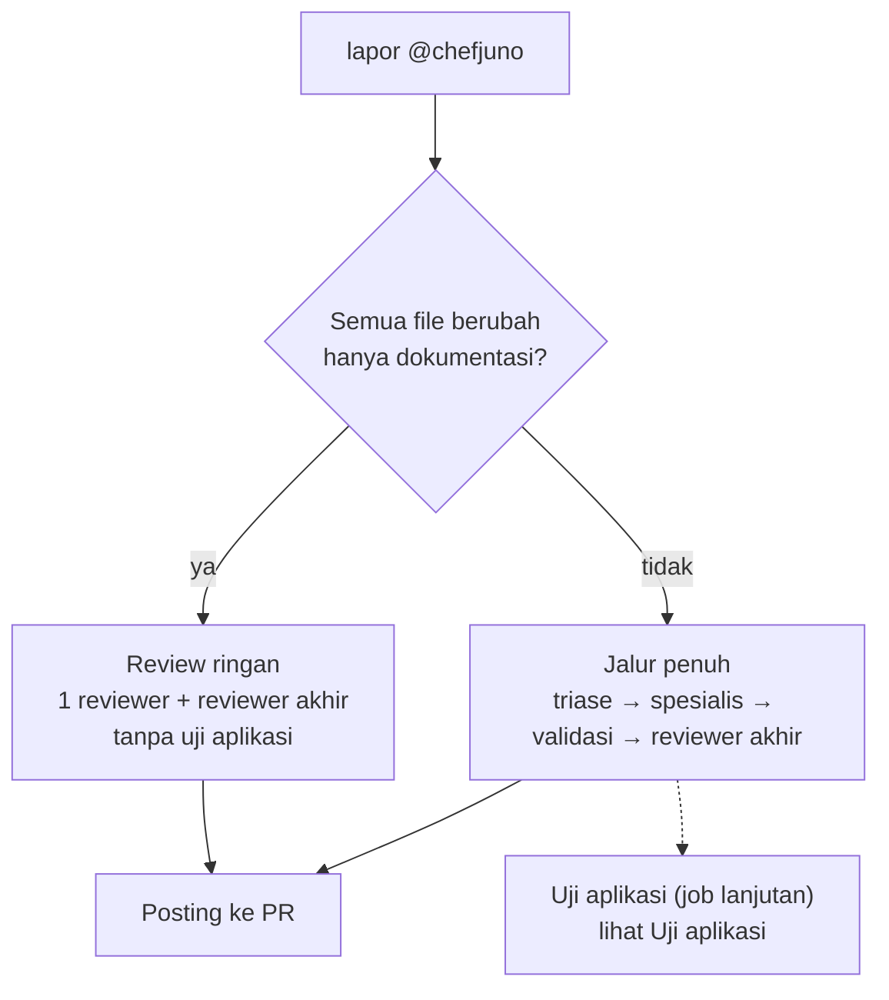
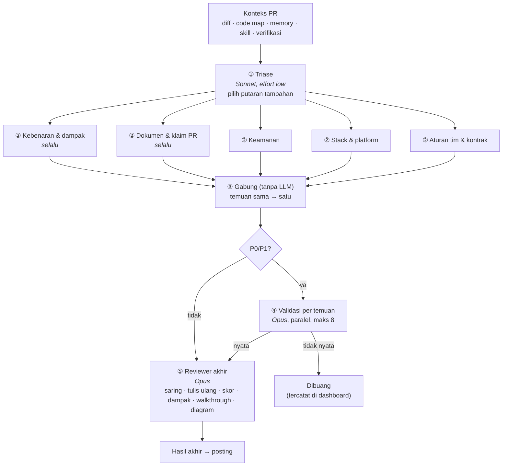

# Standar review

Chef Juno hanya punya **satu standar**: setiap PR kode direview penuh lalu **diuji di aplikasi**. Tidak ada pilihan mode.
Kata `dalam` / `standar` di perintah, mode review, dan profil model di Pengaturan tidak lagi memilih apa pun.

**Hanya dokumentasi** ditentukan aturan path, bukan model: semua file berubah berupa `*.md`/`*.mdx`/`*.rst`/`*.txt`,
isi folder `docs/`, `LICENSE`/`CODEOWNERS`, template issue/PR GitHub, atau gambar. Satu file kode saja → jalur penuh.

## Jalur penuh

| Tahap | Model | Yang dilakukan |
|---|---|---|
| ① Triase | Sonnet, effort low | Dari judul, deskripsi, dan daftar file (tanpa diff), pilih putaran tambahan: keamanan, stack & platform, aturan tim. |
| ② Putaran spesialis | Sonnet, effort high | Agent yang sama dengan konteks penuh, masing-masing satu fokus, berjalan paralel. *Kebenaran* dan *dokumen & klaim PR* selalu jalan. Semua skill inti dimuat. |
| ③ Gabung | — | Deterministik: temuan di file sama, baris berdekatan (±3), judul mirip dianggap satu; keparahan tertinggi dipakai; disepakati ≥ 2 putaran → keyakinan +0,1. |
| ④ Validasi | Opus | Validator skeptis memeriksa satu temuan P0/P1: nyata, diperkenalkan PR ini, akibat sesuai klaim? Diberi skill inti. |
| ⑤ Reviewer akhir | Opus | Menerima temuan bernomor + potongan kode ±12 baris, membuang yang palsu, menulis ulang komentar (judul = akibat, mekanisme, perbaikan + test), skor, tingkat dampak, walkthrough, diagram. Diberi skill inti. |

Review ringan (hanya dokumentasi) memakai satu reviewer Sonnet dengan cek wajib penelusuran & dokumen, lalu reviewer
akhir Opus yang sama.

Semua temuan P0–P2 yang lolos diposting (di atas ambang keyakinan, tidak di-suppress memory tim).

## Pengaman

- **P0 tidak bisa dibuang reviewer akhir**, dan adanya P0 membatasi skor maksimal 2.
- **Tidak boleh dangkal:** putaran *kebenaran* yang menjawab tanpa membuka file diulang sekali dengan teguran; masih
  dangkal → **Review sebagian**.
- Putaran yang gagal (timeout, rate limit) tidak menggagalkan review: hasilnya diberi label **Review sebagian**.
  Kalau **semua** putaran spesialis gagal, job dinyatakan gagal — bukan "bersih".
- Triase gagal → semua putaran dijalankan. Reviewer akhir gagal → temuan tervalidasi dipakai apa adanya.
- Setiap langkah tampil langsung di detail review (**Proses agent**): peran, model, durasi, token, status, dan
  aktivitas agent. Lihat [Cara kerja review](02-cara-kerja-review.md#pantau-di-dashboard).
