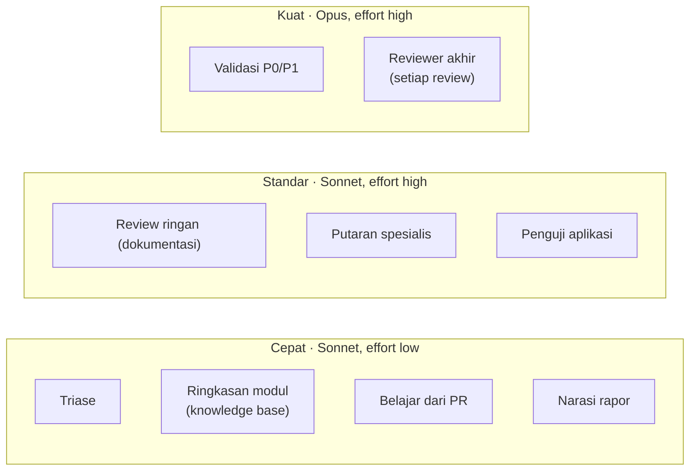

# Model & biaya

Chef Juno tidak memakai API berbayar per token. Semua pemanggilan model memakai **langganan Claude/ChatGPT milik pemilik
mesin** lewat CLI resmi. "Biaya" yang dihemat adalah **jatah pemakaian langganan** dan **waktu**.

Model per peran **tetap** (tidak ada profil Hemat/Seimbang/Maksimal atau tingkat per peran di Pengaturan):
Sonnet mengerjakan, Opus memutuskan.

Nama model dan effort per tingkat masih bisa diubah di **Pengaturan → Model & biaya** (kosong = default):

| Tingkat | Claude Code | Effort Claude | Codex (login ChatGPT) | Effort Codex |
|---|---|---|---|---|
| Cepat | `sonnet` | `low` | `gpt-6.2-sol` | `low` |
| Standar | `sonnet` | `high` | `gpt-6.2-sol` — default harian | `high` |
| Kuat | `opus` | `high` | `gpt-6.2-astra` — paling mampu | `high` |

Haiku sengaja tidak dipakai: pekerjaan ringan memakai Sonnet dengan effort rendah supaya kualitas tetap terjaga.

**Reviewer akhir (Opus) di setiap review.** Opus memeriksa ulang setiap temuan (membuang yang palsu), **menulis ulang
komentarnya** — judul berupa akibat, mekanisme konkret, perbaikan + test — lalu menentukan skor, ringkasan, tingkat
dampak, walkthrough, perkiraan usaha review, dan diagram alur. Ia hanya membaca temuan dan potongan kode di sekitarnya
(±12 baris), bukan seluruh diff. Kalau langkah ini gagal, hasil sebelumnya tetap diposting.

Model diteruskan ke opsi `--model` CLI. Claude Code menerima alias (`sonnet`, `opus`, …) atau nama model lengkap; effort
diteruskan sebagai `--effort` (hanya bila versi CLI mendukung). Untuk Codex, effort diteruskan sebagai
`-c model_reasoning_effort="…"`. Daftar model Codex mengikuti [halaman model Codex](https://learn.chatgpt.com/docs/models)
per November 2026 — perbarui di Pengaturan bila OpenAI mengganti model.

## Kira-kira berapa pemanggilan per review?

| Jenis PR | Pemanggilan agent |
|---|---|
| Hanya dokumentasi | 1 Sonnet + 1 reviewer akhir Opus |
| Kode (jalur penuh) | 1 triase + 2–5 putaran + 0–8 validasi Opus + 1 reviewer akhir Opus, lalu 1 penguji aplikasi |

Setting lain yang memengaruhi pemakaian: **Batas diff**, **Batas waktu review**, **Maks komentar inline**, dan skill tim
dengan `paths:` (skill yang tidak relevan dengan file PR tidak dimuat).

Model, durasi, dan token yang benar-benar dipakai tiap langkah tercatat di detail review (**Proses agent**) dan
Analitik → Biaya & waktu. *Harga per 1 juta token* di Pengaturan hanya untuk estimasi setara API, bukan tagihan.
