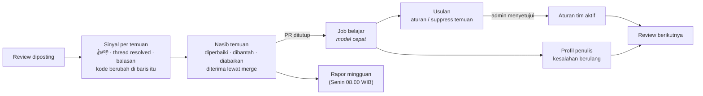

# Memory & knowledge base

Chef Juno punya dua jenis pengetahuan tentang tim: **memory** (apa yang tim putuskan dan kesalahan yang sering diulang)
dan **knowledge base** (struktur kode repo). Keduanya masuk ke setiap review; memory juga dipakai penguji aplikasi.

## Memory: belajar dari tim

**Nasib temuan** ditentukan dari sinyal, berurutan:

| Sinyal | Nasib |
|---|---|
| Kode di sekitar baris itu berubah setelah review, atau AI coder membalas `chefjuno: diperbaiki` | Diperbaiki |
| 👎 lebih banyak dari 👍, balasan manusia yang membantah, atau `chefjuno: tidak diperbaiki — <alasan>` | Dibantah |
| Thread di-resolve | Diperbaiki |
| PR di-merge tanpa sinyal lain | Diterima lewat merge |
| Tidak ada apa-apa | Diabaikan |

Saat PR ditutup, **job belajar** membaca nasib temuan dan mengusulkan:

- **Aturan tim** — dari alasan bantahan yang masuk akal dan berlaku umum di repo.
- **Suppress temuan** — pola yang berulang kali dibantah/diabaikan. Tidak pernah untuk keamanan atau P0.
- **Pelajaran pribadi** — kesalahan yang sama muncul ≥ 2 kali pada penulis yang sama.

Usulan **tidak berlaku sebelum disetujui admin** di halaman **Memory → Usulan**. Aturan aktif dimasukkan ke prompt review
yang path-nya cocok; pola suppress dicocokkan secara deterministik (kemiripan judul + kategori) sebelum posting.

## Fakta yang diingat

Selain aturan, memory menyimpan **fakta** tentang repo dan cara mengujinya. Fakta langsung aktif (tanpa persetujuan)
dan bisa dinonaktifkan di **Memory**.

| Sumber | Cara |
|---|---|
| Perintah di PR | `@chefjuno ingat <fakta>` (juga `catat` / `remember`), mis. `@chefjuno ingat akun uji harus premium supaya kuis terbuka`. Chef Juno membalas 🧠 |
| Uji aplikasi | Pelajaran penguji tentang cara menguji app ini (akun, data uji, cara membuat data) disimpan otomatis, sumber `uji-aplikasi` |

Fakta yang hampir sama dengan yang sudah ada tidak disimpan dua kali. Fakta berlaku untuk repo tempat ia dicatat, dan
dimasukkan ke prompt **reviewer** (sebagai "Fakta yang diingat") dan **penguji aplikasi** berikutnya.

## Knowledge base: code map

Mesin reviewer membangun **code map** lokal (tree-sitter + SQLite FTS5) untuk setiap repo: simbol, pemanggil,
yang dipanggil, referensi, test terkait, dan pengelompokan modul. Job **index** berjalan saat GitHub App dipasang dan saat
ada push ke branch utama (penuh lalu inkremental), lalu meringkas tiap modul dengan model cepat.

Di review, daemon menambahkan bagian *Konteks dari peta kode*: simbol yang diubah PR, siapa pemanggilnya, dan peringatan
dampak — supaya reviewer menilai **efek ke bagian lain repo**, bukan hanya baris yang berubah.

Bahasa yang didukung: TypeScript/TSX, JavaScript, Vue, Python, Go, dan **Dart (Flutter)**.

Untuk Dart, code map mengenali kelas, **widget** (turunan `StatelessWidget`, `StatefulWidget`, `ConsumerWidget`, …), mixin,
extension, enum, typedef, fungsi, method, getter, dan factory; widget yang dipakai di `build()` (termasuk `const Text(...)`)
dicatat sebagai *renders*. Import `package:` diterjemahkan lewat `pubspec.yaml` (termasuk paket lokal di `packages/`),
barrel `export` diikuti, dan nama berawalan `_` dianggap privat. File hasil generator (`*.g.dart`, `*.freezed.dart`,
`lib/gen/`) dilewati. Modul dibagi per fitur (`lib/app/modules/<fitur>`) dan per lapisan (`lib/domain/entities`, …).

## Dipakai agent pribadi developer (MCP)

Memory dan code map yang sama bisa dipakai Claude Code / Codex milik developer saat menulis kode:

| Server MCP | Perintah | Tool (read-only) |
|---|---|---|
| `chefjuno_memory` | `chefjuno memory-mcp` | `get_team_rules`, `get_my_lessons` |
| `chefjuno_graph` | `chefjuno graph-mcp --db … --root …` | `find_symbol`, `get_callers`, `get_callees`, `get_references`, `get_file_outline`, `search_code_symbols`, `get_module_summary`, `get_impact` |

Alternatif tanpa MCP: `chefjuno memory pull --login <github>` menulis aturan tim + kesalahan berulangmu ke file untuk
`CLAUDE.md` / `AGENTS.md`. Petunjuk lengkap ada di dashboard: **Knowledge Base → Hubungkan ke agent**.
