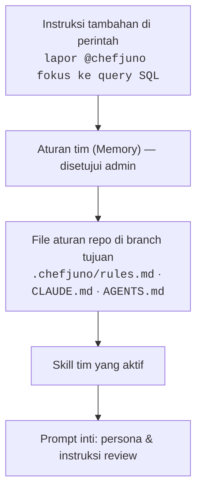
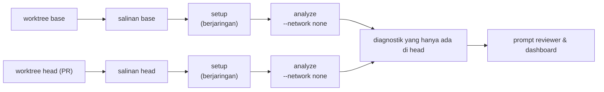

# Kustomisasi

Urutan prioritas instruksi untuk reviewer, dari yang paling kuat:



## Skills

Halaman **Skills** adalah editor: explorer di kiri (prompt inti + folder skill), editor bernomor baris, preview, riwayat
versi, dan status bar. Skill dikelompokkan: **SKILL INTI**, **SKILL DOMAIN**, dan **SKILL LAINNYA** (belum diberi kategori).

- **Prompt inti** (`persona.md`, `review.md`) selalu dipakai. Setiap simpan membuat versi baru; versi bisa diaktifkan
  atau di-rollback, dan dibandingkan berdampingan.
- **`review.md` adalah standar review tim**: bukti (terukur vs disimpulkan), akar masalah, kelas yang selalu P0, kontrak &
  konkurensi, keamanan, desain dari domain, migrasi tuntas, test, sinyal vs noise, memory tim, kelengkapan & skor, dan cara
  menulis temuan. Isinya standar, bukan urutan langkah: agent memakainya sesuai PR. Ubah di sini untuk menyesuaikan
  standar tim.
- **Skill** memakai format skill Claude Code: satu folder per skill berisi `SKILL.md` dengan frontmatter, plus file pendukung.

### Tidak ada skill bawaan

Chef Juno tidak membawa skill bawaan. Standar review umum ada di `review.md`, dan prompt bawaan mode tujuan memberi
tujuan, prinsip, pedoman subagent, dan batas — termasuk kalibrasi keparahan untuk gerbang merge (P0/P1 harus terbukti;
data hilang, auth terlewati, dan biaya tanpa batas selalu P0). Skill dipakai untuk pengetahuan **khusus tim** yang tidak diketahui model.
Pengetahuan khusus repo (cara menjalankan app, akun uji, konvensi) juga ada di `CLAUDE.md`, `AGENTS.md`, skill verify,
dan memory Chef Juno.

Skill tim dengan `category: inti` dipakai di mana saja: reviewer, validator & reviewer akhir pipeline lama, dan penguji
aplikasi.

### Skill tim (domain)

Tim bisa mengimpor skill sendiri, mis. konvensi Flutter tim:

```markdown
---
name: flutter-tim
description: Konvensi widget & state di aplikasi kami.
category: domain
paths:
  - "**/*.dart"
---

# Isi skill …
```

- `category: domain` — tampil di kelompok SKILL DOMAIN. Tanpa `category` → SKILL LAINNYA.
- `paths:` (opsional) — glob file. Skill hanya dimuat kalau PR mengubah file yang cocok. Tanpa `paths`, skill selalu dimuat.
- **Import massal**: tarik folder, beberapa file `.md`, atau `.zip`. Skill dari anggota masuk nonaktif sampai diaktifkan admin.

Skill dibaca agent sebagai instruksi di system prompt. Skrip di dalam skill **tidak dijalankan** (reviewer berjalan tanpa
tool eksekusi). **Analitik → Skills** menunjukkan seberapa sering tiap skill dipakai dan hasilnya — hanya skill yang
masih ada.

## Aturan tim (Memory)

Tambah langsung di **Memory → Tambah aturan** (Markdown, bisa dibatasi path), atau setujui usulan dari job belajar.
Aturan bisa diedit dan dinonaktifkan dengan switch tanpa dihapus.

## File aturan repo

`.chefjuno/rules.md`, `CLAUDE.md`, dan `AGENTS.md` dibaca dari **branch tujuan** PR, bukan dari PR itu sendiri —
PR tidak bisa mengubah aturan yang dipakai untuk mereviewnya.

## Verifikasi statis: `.chefjuno/verify.json`

Aktifkan di **Pengaturan → Review → Verifikasi statis**, lalu tambahkan file ini di branch utama repo:

```json
{
  "image": "ghcr.io/cirruslabs/flutter:stable",
  "setup": ["flutter pub get"],
  "analyze": ["flutter analyze --no-pub"],
  "timeoutSec": 600
}
```



| Field | Keterangan |
|---|---|
| `image` | Image container (Docker/Podman) |
| `setup` | Maks 5 perintah, boleh berjaringan (unduh dependensi). Untuk npm pakai `npm ci --ignore-scripts` |
| `analyze` | 1–5 perintah, **tanpa jaringan**. Output head dibandingkan dengan base |
| `timeoutSec` | 30–1800, default 600 |

Mesin tanpa Docker/Podman melewati tahap ini dan mencatat alasannya; review tetap jalan.

## Pengaturan

Tidak ada lagi mode review, prioritas yang diposting, profil model, atau tingkat per peran: satu standar berlaku untuk
semua PR (lihat [Standar review](03-review-mendalam.md)) dan semua temuan P0–P2 diposting.

| Bagian | Setting |
|---|---|
| Review | Maks komentar inline (0–30), ambang keyakinan, agent pilihan, verifikasi statis, [uji aplikasi](09-uji-aplikasi.md) |
| Model & biaya | Nama model & effort per tingkat (Claude Code, Codex), harga per 1 juta token (estimasi), batas waktu review, batas diff |
| Anggota | Tambah lewat login GitHub, peran Admin/Anggota |
| Repositori | Aktif/nonaktif review per repo, status code map |
