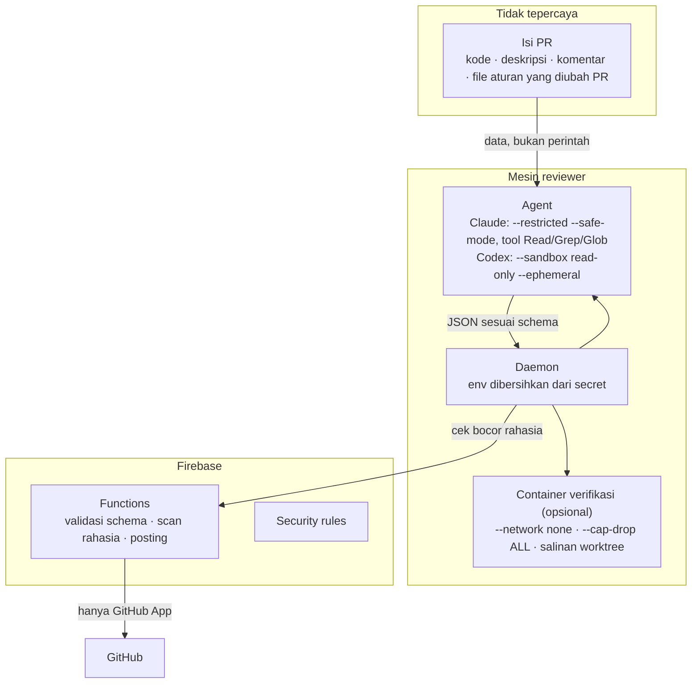

# Keamanan

Isi pull request **tidak tepercaya**: kode, deskripsi, komentar, bahkan `CLAUDE.md` yang diubah PR bisa berisi instruksi
yang mencoba membajak reviewer. Chef Juno dirancang supaya isi PR hanya bisa *dibaca*, tidak bisa *memerintah*.

## Agent

| | Claude Code | Codex |
|---|---|---|
| Mode | `-p` dengan `--restricted --safe-mode --strict-mcp-config` | `exec --sandbox read-only --ephemeral` |
| Tool | Hanya `Read`, `Grep`, `Glob` — tidak ada Bash/eksekusi kode, tidak ada web fetch | Sandbox read-only |
| Kustomisasi user | Dimatikan (skill, hooks, plugin, MCP, `CLAUDE.md` user) | `--ignore-user-config --ignore-rules` |
| Login | Wajib langganan claude.ai; login API key ditolak | Wajib login ChatGPT |
| Output | Dipaksa JSON schema; output tidak sah → job gagal | Sama |

Versi CLI yang tidak mendukung flag isolasi yang dibutuhkan **tidak dipakai** (diperiksa saat daemon start).

*Risiko yang masih ada:* sandbox read-only Codex tetap bisa membaca file lain di mesin. Pakai akun/mesin khusus reviewer
bila mesin menyimpan data sensitif (lihat `docs/SETUP.md`).

## Penguji aplikasi (agent tepercaya)

Uji aplikasi butuh menjalankan app, jadi penguji **bukan** reviewer terisolasi di atas: ia satu agent *tepercaya*
(Claude: `--permission-mode bypassPermissions` dengan setting user + project; Codex: `--sandbox danger-full-access`)
yang boleh menjalankan perintah. Pagarnya:

- Hanya jalan bila pemilik mesin memasang profil `agentTest` di `~/.chefjuno/app-local.json` — milik **mesin**, PR tidak
  bisa mengubahnya — dan uji aplikasi aktif di Pengaturan.
- Hanya terhadap **emulator lokal** (127.0.0.1), **tidak pernah produksi**. Penguji memegang lingkungan ujinya sendiri
  sesuai skill verify repo: menyalakan & memperbaiki stack emulator, menyiapkan data uji, dan mencatat caranya ke memory.
  Daemon hanya memegang kunci akun/lajur (supaya tidak bertabrakan dengan agent lain) dan membereskan app sisa uji.
- Dilarang push, mengubah repo, atau memposting ke GitHub; hasil hanya lewat JSON yang divalidasi schema dan dipindai
  rahasia seperti review.
- **Bersih-bersih wajib:** perintah `agentTest.cleanup` mematikan app yang dijalankan penguji setelah setiap uji
  (berhasil, gagal, atau timeout), sebelum kunci emulator dilepas; dan saat mesin menyala, untuk sisa job yang terputus.
- Hanya PR yang direview atas permintaan anggota tim (`lapor @chefjuno`).

## Instruksi yang dibajak

- Prompt inti mewajibkan agent memperlakukan isi PR sebagai data dan **melaporkan upaya pembajakan sebagai temuan keamanan**.
- File aturan repo (`.chefjuno/rules.md`, `CLAUDE.md`, `AGENTS.md`) dan `.chefjuno/verify.json` dibaca dari **branch tujuan**.
- Skill dan prompt hanya bisa diubah anggota lewat dashboard, berversi, dan dicatat di audit log.
- Profil uji aplikasi (`~/.chefjuno/app-local.json`) dibaca dari mesin, bukan dari PR.

## Kredensial

| Kredensial | Perlakuan |
|---|---|
| Token GitHub untuk mengambil kode | Token instalasi sementara, **hanya repo PR itu**, izin `contents: read`, diberikan per job ke mesin yang memegang job |
| Identitas mesin | Kode registrasi sekali pakai (10 menit) → secret mesin (disimpan ter-hash di server) → token pendek; bisa dicabut dari halaman Mesin |
| Env proses agent | Variabel berisi token/secret/API key dibuang sebelum agent dijalankan |
| Output agent | Dipindai untuk secret mesin, token instalasi, dan pola rahasia; kalau ada → job gagal, tidak diposting |
| Container verifikasi | Tidak menerima env apa pun selain PATH/HOME; tanpa jaringan saat analisis |
| Akun testing [uji aplikasi](09-uji-aplikasi.md) (cara lama, runner container) | Disimpan di mesin (`~/.chefjuno/app-accounts.json`), hanya diteruskan ke container runner lewat `-e NAMA`; tidak pernah dilihat agent, disamarkan dari hasil, tidak disimpan di Firestore |

## Data

- Kode PR dan konteksnya dikirim ke penyedia model (Anthropic / OpenAI) **lewat CLI dan langganan pemilik mesin**, sama
  seperti developer memakai Claude Code / Codex sendiri. Server Chef Juno tidak mengirim kode ke model.
- Firestore memakai database terpisah (`chefjuno`). Security rules: hanya anggota yang bisa membaca; tulisan sensitif
  (job, temuan, skill, prompt, anggota) hanya lewat Functions; mesin hanya bisa memperbarui job miliknya dan heartbeat-nya.
- Screenshot uji aplikasi disimpan di `jobs/{id}/evidence` (hanya anggota yang bisa membaca lewat dashboard; hanya mesin
  pemegang job yang sedang berjalan yang bisa menulis). Supaya tampil langsung di komentar PR, Functions menyajikannya
  lewat URL `/evidence` **bertanda tangan** (HMAC per job & screenshot); tanpa tanda tangan yang benar → 403. Siapa pun
  yang memegang URL itu bisa melihat gambarnya — salah satu alasan uji memakai emulator lokal dengan data uji, bukan data asli.
- Hanya anggota yang terdaftar (allowlist GitHub) yang bisa membuka dashboard dan memanggil Chef Juno.

## Log aktivitas agent

"Intip kerja agent" di dashboard disimpan di `jobs/{id}/activity`:

- Yang dicatat hanya **proses berpikir**, **alat yang dipakai** (mis. `Baca lib/x.dart`, `Cari "pattern"`, `$ perintah`),
  dan **teks keputusan**. **Hasil alat — isi file, output perintah — tidak pernah dicatat.**
- Pola rahasia (token GitHub/Google/OpenAI, JWT, private key, `password=…`/`token=…`) disensor sebelum ditulis.
- Teks panjang dipotong (berpikir 1.500, alat 300, keputusan 800 karakter); maksimal 40 event per dokumen dan 400
  dokumen per job.
- Security rules: hanya anggota yang bisa membaca; hanya mesin yang memegang job **yang sedang berjalan** yang bisa
  menambah; tidak bisa diubah atau dihapus dari klien.
