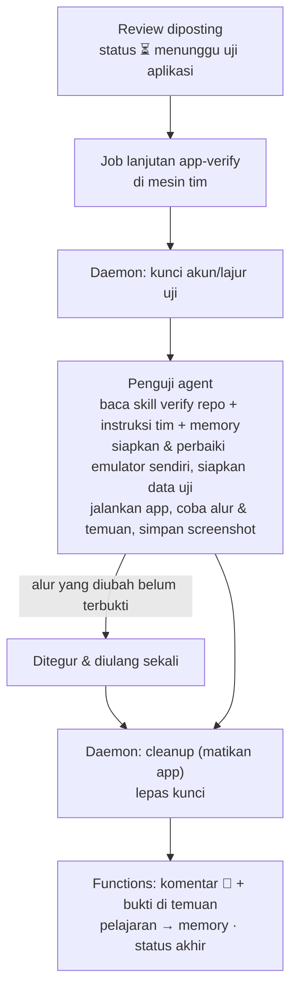

# Uji aplikasi

Membaca kode belum membuktikan aplikasi berjalan benar. Karena itu setiap PR kode (bukan yang hanya dokumentasi)
**dicoba langsung di aplikasi** setelah review diposting. PR yang belum teruji **tidak pernah lulus**.



## Yang dicoba

- **Alur yang diubah PR — selalu**, walau review tidak menemukan apa pun: dicoba sebagai pengguna untuk membuktikan
  perubahan bekerja dan tidak merusak layar.
- Hingga 4 **temuan review** yang bisa terlihat di aplikasi (P0–P2, urut keparahan lalu keyakinan). Kategori *test* dan
  *maintainability* tidak dicoba.
- Temuan yang tidak bisa dicoba dilewati dengan alasan yang tercatat.

### Deskripsi PR bertemplate

Penguji dan reviewer membaca deskripsi PR. Kalau deskripsi mengikuti template dengan heading yang dikenali, bagiannya
diubah menjadi brief terstruktur, bukan dipotong apa adanya:

| Heading di deskripsi (salah satu) | Masuk brief sebagai |
|---|---|
| `Why`, `Alasan` | Alasan (dari penulis) |
| `Behavior change`, `Perubahan perilaku` + `Affected screens and flows`, `Alur terdampak` | **Alur yang diubah PR** — daftar layar yang wajib dicoba semua |
| `How to try it`, `Cara mencoba` dengan label `Account`/`Akun`, `Data`, `Steps`/`Langkah` | **Cara mencoba** — akun, data uji, dan langkah |
| `Out of scope`, `Risk`, `Verification` (dan padanan Indonesianya) | Di luar cakupan, risiko, verifikasi oleh penulis |

Komentar HTML (petunjuk template) dibuang, dan heading di dalam blok kode tidak dihitung. Deskripsi tanpa bagian
*alur terdampak* atau *cara mencoba* dipakai seperti biasa (4.000 karakter pertama). Penguji tetap memeriksa daftar
file: layar lain yang memakai kode yang berubah ikut dicoba. Temuan "alur rusak" ditempel ke file kode dengan
perubahan terbanyak (bukan test atau dokumentasi).

## Penguji agent

Satu agent **tepercaya** (boleh menjalankan perintah) bekerja di worktree PR:

1. Membaca berkas di `readFirst` dan **skill verify repo** (`.claude/skills/verify/SKILL.md`), lalu mengikutinya untuk
   menjalankan app, menyetirnya, dan mengambil screenshot.
2. Menguji secara interaktif: lihat layar, bertindak, lihat lagi. Nama tombol/rute dicari dari kode, bukan ditebak.
3. **Menyiapkan data uji sendiri** bila layar masih kosong (mis. riwayat kuis untuk grafik) — lewat UI atau langsung ke
   database **emulator lokal (127.0.0.1)**. Tidak pernah menulis ke produksi.
4. **Wajib menyimpan screenshot** bukti. "Berjalan normal" tanpa screenshot dianggap belum teruji.
5. Melapor status per item: *terbukti* (masalah terlihat), *tidak muncul* (berjalan normal), *belum meyakinkan*
   (tidak sampai layar yang diuji, sebut penghalangnya), plus **pelajaran** tentang cara menguji app ini.

Penguji mendapat skill inti `bukti` dan `jujur-soal-kelengkapan`, instruksi tim, dan fakta dari memory Chef Juno.
Pelajarannya (mis. "akun uji harus premium supaya kuis terbuka", cara membuat data uji) disimpan sebagai fakta memory
(sumber `uji-aplikasi`) dan dipakai uji berikutnya — lihat [Memory](05-memory-dan-knowledge.md#fakta-yang-diingat).

## Hasil

| Hasil | Efek | Di PR |
|---|---|---|
| Alur yang diubah **rusak** | temuan baru P1 "Alur yang diubah PR bermasalah…" | ❌ `FAIL · alur yang diubah rusak saat dicoba di aplikasi` |
| Alur berjalan + screenshot, kode PASS/PASS+NOTES | — | ✅ `… · teruji di aplikasi` |
| Uji jalan, kode FAIL | — | ❌ tetap FAIL |
| Tidak teruji (uji dilewati/gagal, alur belum berhasil dicoba, tanpa screenshot) | — | ⚠️ `Belum teruji …` |
| Temuan **terbukti** | keyakinan naik ke minimal 95% | bukti ditempel di komentar inline temuan |
| Temuan **tidak muncul** | keyakinan × 0,6 (dashboard) | catatan di komentar inline temuan |

Chef Juno memasang satu komentar sticky **🧪 Uji aplikasi** di PR (diperbarui tiap uji): hasil alur yang diubah, temuan
yang dicoba, yang dilewati beserta alasannya, dan **screenshot inline**. Gambar disajikan lewat URL `/evidence` di domain
dashboard yang bertanda tangan (lihat [Keamanan](07-keamanan.md#data)); screenshot aslinya disimpan di
`jobs/{id}/evidence`. Prosesnya bisa dipantau langsung di detail review: langkah **Uji aplikasi (agent mencoba app)**
dan *Intip kerja agent*.

## Menyiapkan mesin: `~/.chefjuno/app-local.json`

Profil ini milik **mesin**, bukan repo — PR tidak bisa mengubah cara dirinya diuji. Kunci = nama repo.

```json
{
  "tim/aplikasi-mobile": {
    "agentTest": {
      "instructions": "Jalankan web dengan ./scripts/app.sh start web chefjuno, login dengan akun emulator D8. Jangan membeli paket.",
      "readFirst": ["/Users/saya/work/.claude/skills/verify/SKILL.md"],
      "timeoutMin": 40,
      "cleanup": [{ "command": ["./scripts/app.sh", "stop", "web", "chefjuno"] }]
    },
    "emulator": {
      "requirePorts": [9399, 8399],
      "locks": [{ "acquire": ["/path/lane-lock.sh", "acquire", "D8", "chefjuno"],
                  "release": ["/path/lane-lock.sh", "release", "D8", "chefjuno"],
                  "env": { "LANE_LOCK_PID": "{{pid}}" } }],
      "prepare": [{ "command": ["/path/emu-stack.sh", "reset", "D8"], "env": { "EMU_HOLDER": "chefjuno" } }],
      "repair": [{ "command": ["/path/emu-stack.sh", "rebuild"] }]
    }
  }
}
```

| Field | Keterangan |
|---|---|
| `agentTest.instructions` | Instruksi tim untuk penguji: cara launch, akun, hal yang tidak boleh diklik (maks 6.000 karakter) |
| `agentTest.readFirst` | Berkas yang wajib dibaca dulu (path absolut, maks 10). Skill verify repo dibaca otomatis |
| `agentTest.timeoutMin` | Batas waktu penguji, 5–90 menit, default 40 |
| `agentTest.cleanup` | Maks 5 perintah yang **mematikan app** yang dijalankan penguji. Dijalankan di worktree PR setelah setiap uji (berhasil, gagal, timeout), dan saat mesin menyala untuk sisa job yang terputus — app yatim tidak boleh memegang akun emulator |
| `emulator.locks` | Kunci akun/lajur uji bersama (penahan = proses yang hidup selama uji, `{{pid}}`). Dilepas terbalik setelah cleanup |
| `emulator.requirePorts`, `prepare`, `repair`, `start` | Opsional: persiapan yang dijalankan daemon sebelum agent. Biasanya kosong — penguji yang menyalakan, memperbaiki, dan mengisi emulator sesuai skill verify (lebih tahan terhadap kondisi tak terduga) |

Lalu aktifkan **Pengaturan → Review → Uji aplikasi**. Tanpa profil `agentTest` atau dengan uji dimatikan, PR kode tidak
diuji dan tidak bisa ✅ teruji.

Perintah langkah (`prepare`, `repair`, `start`, `cleanup`) berbentuk `{ "command": [...], "env": {...}, "timeoutSec": 300 }`.
Lingkungan uji (emulator, data, akun) dipegang **penguji**; daemon memegang kunci dan menjalankan cleanup.

## Pagar pengaman

- Hanya **emulator lokal**, tidak pernah backend produksi; data uji dibuat di emulator.
- Penguji dilarang push, mengubah repo, atau memposting ke GitHub; hasilnya hanya JSON yang divalidasi schema dan
  dipindai rahasia.
- Hanya PR yang direview atas permintaan anggota tim (`lapor @chefjuno`).
- Laporan yang terlalu panjang dipotong, bukan ditolak; laporan tidak sah → uji dianggap tidak jalan (Belum teruji).
- Detail isolasi dan risikonya: [Keamanan](07-keamanan.md#penguji-aplikasi-agent-tepercaya).

## Batasan

- Screenshot diubah ke JPEG ≤ 1280 px dengan `sips` (macOS); maks 6 per item, ±700 KB per gambar.
- Penguji hanya bisa mencoba apa yang bisa dijalankan skill verify repo di mesin itu.
- Uji bisa makan beberapa menit; lease job diperpanjang otomatis selama berjalan.

## Cara lama: runner container (tanpa `agentTest`)

Kalau profil mesin tidak punya `agentTest`, daemon masih bisa memakai jalur lama: build web PR di container dari
`.chefjuno/app.json` (branch tujuan) atau `config` di profil mesin, agent merencanakan langkah klik/isi/screenshot,
runner Playwright di container menjalankannya, lalu agent kedua menilai. Jalur ini butuh Docker/Podman, dan — tanpa
bagian `emulator` (`patches`, `definesCommand`, `forwardPorts`, `account`) — berjalan di backend sungguhan dengan akun
testing di `~/.chefjuno/app-accounts.json`. Jalur agent di atas disarankan; jalur lama tidak dikembangkan lagi.
